## Вступление

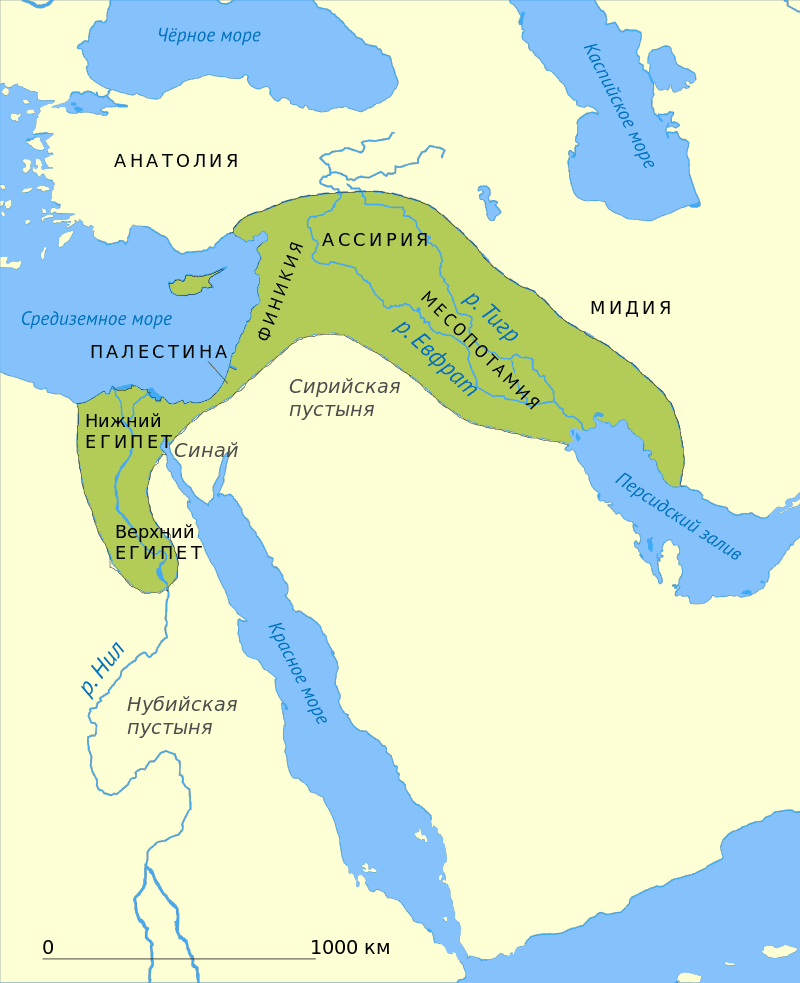

- Месопотамия - от греческих слов месос (середина) и потамос (река). Междуречье, Двуречье - так называют его в русской историографии.
- Две реки - это Тигр и Евфрат, колыбель первых цивилизаций.
- Они протекают по территории современных Турции, Сирии и Ирака.

---

## Кто же здесь жил?

- Языки, на которых говорили в Месопотамии (аккадский, вавилонский, ассирийский, арамейский) - это семитские языки, родственные арабскому и ивриту.
- Культура Месопотамии не канула в забытье, отдельные её практики легли в основу более поздних культур (и в том числе в христианскую культуру).

# Хронология и география

## География и природные условия

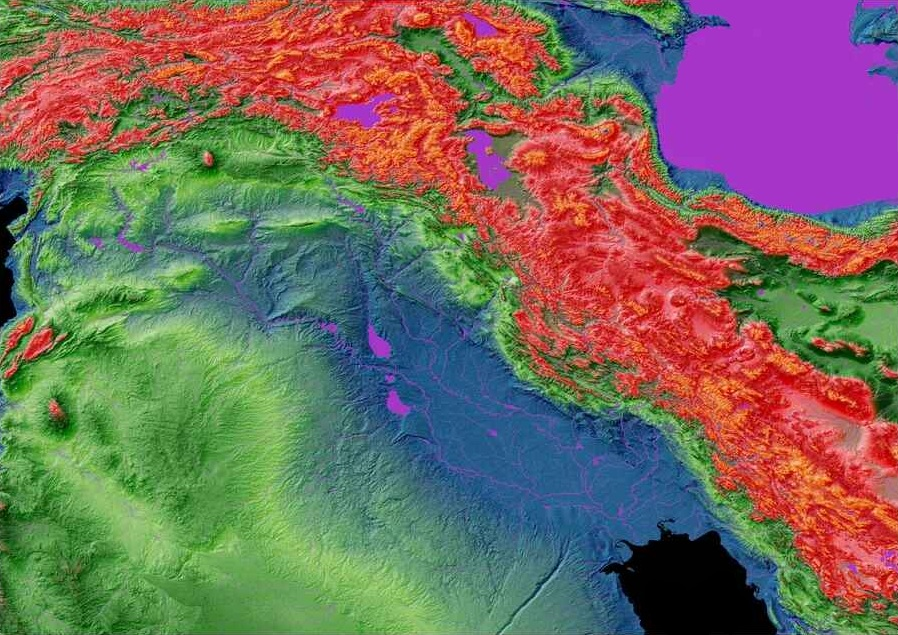

---

- Месопотамия - это равнина с двумя полноводными не пересыхающими реками (синий цвет).
- На северо-востоке от неё - Иранское нагорье (красное), которое защищает и от набегов с севера, и от проливных дождей с Черного поря - горы задерживают осадки.
- На юго-западе - Сирийская степь (зеленая), главный источник пылевых бурь и жары.

## ПОЛОВОДЬЕ

## Половодье

- **Половодье** — это фаза водного режима реки, которая ежегодно повторяется в один и тот же сезон и характеризуется высоким и длительным подъемом уровня воды. Река разливается и затопляет берега вместе со всем, что на этих берегах находится.

---

---

## Половодье у рек Тигр и Евфрат

- Тигр и Евфрат разливались регулярно, непредсказуемо и катастрофически сильно. русла рек не просто расширялись на десятки километров, они еще и углублялись на 3-4 метра и могли затопить целый город.

---

- При этом, когда Тигр и Евфрат успокаивались и принимали свой прежний вид, на земле оставался ил - отличное удобрение для сельского хозяйства.
- Поймы рек Тигр и Евфрат позже назовут Плодородным Полумесяцем.
- Необходимость копать каналы и контролировать разливы рек вынудила разрозненные общины объединяться в строго организованные государства.

## Характер реки как зеркало Мифа

- Река для любой древней цивилизации является центром мира.

- И у жителей Месопотамии было к рекам двойственное отношение: с одной стороны, река - это кормилица, это основа мироздания. Без воды в этих реках не было бы людей.
- С другой стороны, река беспощадна и в половодье может уничтожить посевы, скот, деревни, храмы и города.
- Это самым прямым образом отразилось на религиях Месопотамии: божества в них - это мощные и непредсказуемо враждебные создания. Они создали людей, но мечтают уничтожить их за излишнюю непокорность.
- У людей остается 2 выхода: либо истово молиться, либо водить их за нос, как делал это герой эпоса Гильгамеш.

## Периоды истории Месопотамии

- Название периода почти всегда указывает на город или регион, который стал главной силой в Древнем Ближнем Востоке.
- Сначала доминирует юг (Шумер), затем центр (Аккад, Вавилон), затем север (Ассирия).

#### Что менялось каждый период?

- Главное государство в регионе, культурные нарративы, политический фон.
- Культура прошлых периодов никуда не исчезала - она становилась основой для новой.
- Народы тоже никуда не исчезали - они смешивались друг с другом.

---

- **Шумер (IV — конец III тыс. до н.э.):** зарождение первых городов-государств (Урук, Ур, Лагаш), изобретение клинописи, сложение канона храмовой архитектуры на платформах.

- **Аккад (XXIV — XXII вв. до н.э.):** первая централизованная военная империя Древнего Востока, рождение культа царя-победителя и экспрессивного триумфального рельефа.

- **Старовавилонское царство (XVIII — XVI вв. до н.э.):** расцвет при царе Хаммурапи, создание первого кодекса писаных законов, монументализация права.

- **Ассирийская держава (IX — VII вв. до н.э.):** милитаризованная империя, гигантские дворцовые комплексы, шеду-хранители и натуралистичные батальные барельефы.

- **Нововавилонское царство (VII — VI вв. до н.э.):** архитектурный ренессанс эпохи Навуходоносора II, расцвет глазурованного полихромного декора и грандиозное градостроительство.

# Этапы развития

## Четыре столпа месопотамской культуры

- **Шумер:** сакральная архитектура на платформах, экспрессивные большеглазые адоранты, повествовательные инкрустированные фризы.

- **Аккад:** переход от служения божеству к утверждению величия вождя-завоевателя, динамизм и портретные черты.

- **Ассирия:** искусство военной пропаганды и устрашения, грандиозные дворцовые комплексы, охранительная монументальная скульптура и драматичные рельефы охоты.

- **Новый Вавилон:** триумфальный полихромный декор из глазурованного кирпича, архитектурная грандиозность и символическая защита столицы мира.

## ШУМЕР

## Рождение цивилизации и города-государства

- Шумеры - загадка истории.
- шумерский язык относят к языку-изоляту, то есть, это уникальный язык без родственников. он вымер еще в первых веках нашей эры, а разговорным перестал быть еще раньше - поэтому мы даже не знаем, как он звучал.
- мы точно не знаем, откуда шумеры тут взялись
- скорее всего, этот древний народ спустился в Месопотамию с Иранского нагорья либо пришел с моря. до них здесь уже жила древнейшая первобытная культура неизвестного происхождения и всё, что мы обсуждали про каналы и земледелие, они уже успели придумать сами.
- шумеры приносят этим людям письменность на основе клинописи, а значит дают мощный толчок культуре и экономике.

# ПИСЬМЕННОСТЬ

## Письменность дает возможность...

- Вести учет хозяйства => Систематизирует его и позволяет создать экономику
- Записать прежде устные сказания => Культура получает материальный носитель и теперь эффективнее сохраняется и развивается
- Задокументировать исторические факты => История начинает глубже влиять на культуру, так как сохраняется надёжнее
- Зафиксировать законы => Люди начинают жить по писанным правилам

## Города-государства шумерского периода

- Сначала это были общинные храмы, вокруг которых стояли жилые домики.
- Позже эти поселения стали укреплять и в наиболее укрепленные из них стали переезжать жители менее защищенных деревень.
- Так за крепостными стенами выросли первые города-государства.
- Они управлялись советом жрецов (теократия), а после того, как начали друг с другом воевать - царями.

## Архитектура Шумера

Большая часть архитектуры Древнего мира - это храмы.
Для древнего человека (особенно жителя Древнего Востока) приоритет божественной милости однозначно стоял несоизмеримо выше его личности. Жилые постройки строились из гораздо менее живучих материалов, они были достаточно функциональны и однообразны и до наших дней почти не дошли.
Храм же - это зеркало культуры и отношения людей к миру.

Как мы уже сказали, на этих равнинах не растут деревья, только маленькие степные деревца. Также здесь нет пещер и скал для добывания камня и металла. Это приводит к тому, что для строительства будет использоваться только сырцовый кирпич - речная глина+песок+солома.

Даже человека по шумерским легендам боги создали из глины.
А храм - это всегда подобие Космоса либо прообраз человека.

Поэтому храмы Месопотамии выглядят очень похоже - они построены из одного и того же материала. все другие материалы будут редкостью и роскошью - из них будут сделаны самые сакральные предметы.

## Великий зиккурат в Уре

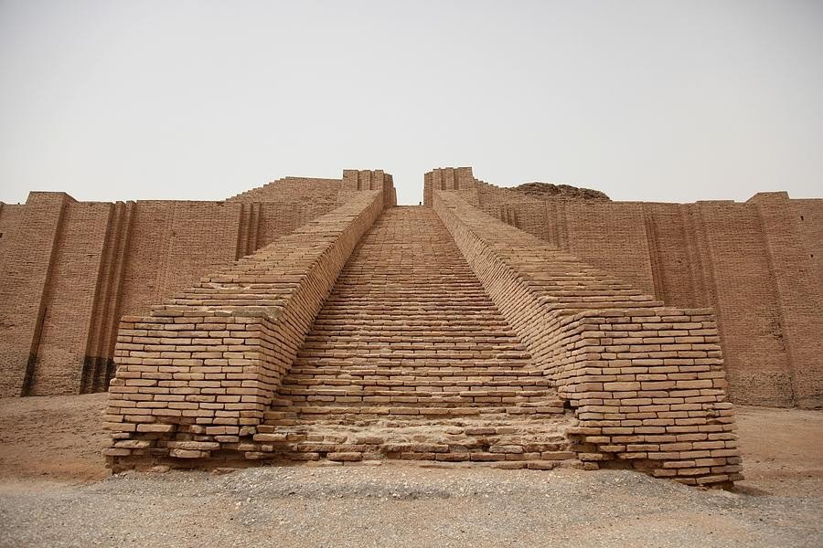

---

Зиккурат - это храм в виде многоступенчатой пирамиды.
сочетание функции и философии.

- Храм мыслился как «лестница к богам» и точка пересечения земного и небесного миров. Именно поэтому он ступенчатый - архитектура храма предполагает, чтобы по нему поднимались.
- Почему зиккурат такой высокий? Причина техническая:
- Сырцовый кирпич быстро разрушался от дождей и ветров, поэтому все культовые постройки возводились на высоких искусственных насыпях.
- Кроме того, насыпи эти позволяли спасти реликвии на вершине храма от наводнений.

---

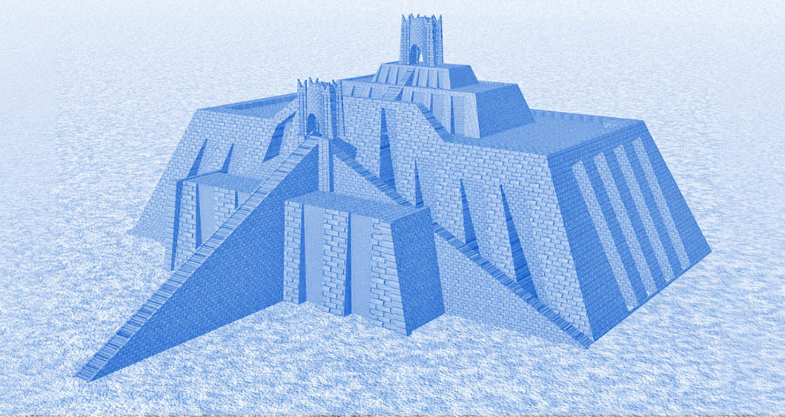

---

- **Контекст:** Конец III тыс. до н.э. (эпоха III династии Ура, ок. 2100 г. до н.э.), построен правителем Ур-Намму в честь лунного бога Нанны.

- **Описание:** Трехъярусная усеченная пирамида со скругленными гранями. Массивное сырцовое ядро облицовано прочным обожженным кирпичом на битумном растворе. Три монументальные лестницы сходились на уровне первой террасы. Применён архитектурный прием расчленения стен: глухие плоскости оформлялись чередующимися выступами и нишами для создания игры светотени и конструктивной прочности.

- **Идея:** Символ мировой горы, связующее звено между небом и землей, вечный памятник прочности царской власти.

## Белый храм в Уруке

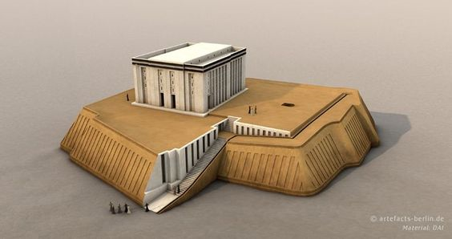

---

- **Контекст:** Конец IV тыс. до н.э. (ок. 3200 г. до н.э.), протописьменный период Шумера. Посвящен верховному богу неба Ану.

- Прямоугольное в плане здание из кирпича-сырца, покрытое белой известковой обмазкой. Возведено на высокой платформе высотой около 13 метров с пандусами и лестницами.

- **Идея:** Преодоление горизонтального ландшафта плоской равнины и физическое приближение жрецов к небесным божествам.

# Скульптура

## Адоранты

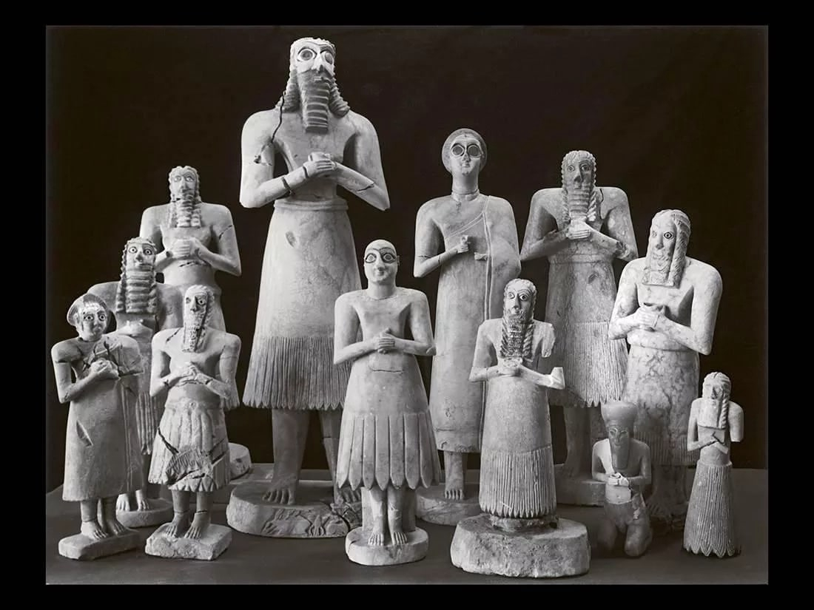

---

Адорант— это изображение или фигурка молящегося человека с простёртыми к небу или сложенными на груди руками.
Термин происходит от латинского слова _adoratio_ — поклонение.

На плече адоранта обычно была выбита надпись, сообщающая, кто был его владельцем. голова как правило больше тела, на теле же одеяние в виде ярусной юбки из овечьей шерсти (каунакес).

---

- **Вотивная функция:** фигурки предназначались не для украшения, а для постоянного стояния перед алтарем в храме вместо живого человека.

- Отсюда преувеличенные глаза: инкрустированные перламутром и лазуритом широко распахнутые глазницы - символ непрерывной молитвы и вечного бдения

## Статуя сановника Эбих-Иля

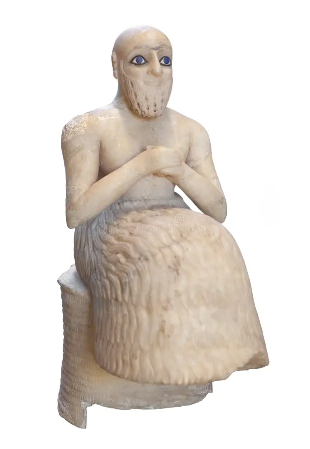

## Штандарт из Ура

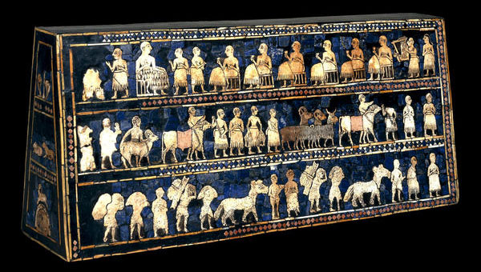

---

- Предмет церемониального назначения (ларец или резонатор арфы).

- Полая деревянная трапециевидная коробка, покрытая трехъярусной мозаикой из лазурита, перламутра и красного известняка. Сторона «Война» показывает триумф армии и боевые колесницы; сторона «Мир» демонстрирует ритуальный пир и подношение даров.

- Композиция традиционна для месопотамских росписей: горизонтальные линии, по которым строится развитие событий в хронологическом порядке

---

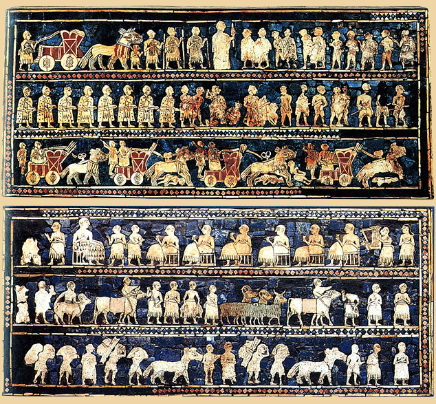

---

- Фигуры показаны специфически: тело анфас, голова профиль. в рамках плоскостного рисунка такой выбор ракурсов позволял показать каждую часть тела с самой узнаваемой стороны
- Здесь мы видим, что Фигура правителя крупнее всех остальных персонажей. это Иератический масштаб - тот, кто главнее и важнее, тот и больше. поэтому правители городов и божества будут почти в 2 раза выше остальных персонажей: воинов, пахарей, слуг.

---

Шумерские города со временем превратились из теократий (где правили жрецы) в воюющие друг с другом города-государства под властью царей.
разрозненные шумерские города в итоге расплатились за свои междоусобицы

## АККАДСКАЯ ИМПЕРИЯ

## АККАДСКАЯ ИМПЕРИЯ

Триумф Аккада: рождение культа вождя

- В XXIV в. до н.э. царь Саргон Древний подчиняет шумерские города, создавая первую в истории централизованную империю.

- Происходит культурный сдвиг: вместо смиренного почитания божеств на первый план выходит триумф земного монарха-завоевателя.

- Искусство обретает анатомическую убедительность, пластическую экспрессию и динамику движения.

## Бронзовая голова Саргона Аккадского

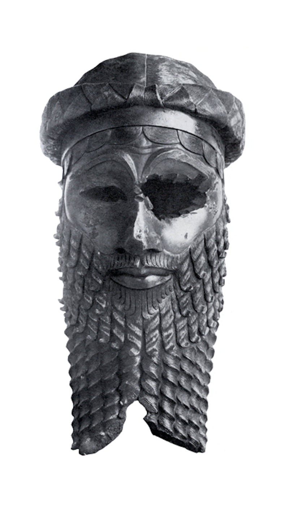

---

- Это часть полноразмерной царской статуи, которая была установлена в Ниневии в знак покорения этого царства Аккадом и лично царем Саргоном

- Высочайший уровень обработки металла. Чеканная графичная проработка прядей бороды и прически сочетается с моделировкой надменного, царственного лица. Глазницы были повреждены врагами при захвате города.

- **Идея:** Воплощение непоколебимой абсолютной монархии, переход от обобщенного типажа к выразительному портретному образу.

## Стела Победы царя Нарам-Сина

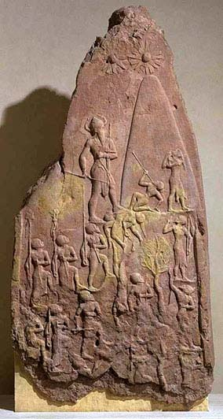

---

- Монумент в честь победы аккадского войска над горным племенем луллубеев (название племени запоминать необязательно).

- Высокая стела из розового песчаника. Мастер отказался от традиционных горизонтальных полос: композиция динамично разворачивается по диагонали вверх по склону горы. На вершине царь Нарам-Син в рогатом шлеме попирает поверженных врагов под лучами небесных светил.

- **Идея:** Прямое обожествление правителя при жизни (рогатый шлем — атрибут богов) и его возвышение над людьми и пространством.

---

## Словарь эпохи Шумера и Аккада

- **Зиккурат** — культовое ступенчатое сооружение в Древней Месопотамии, состоящее из нескольких террас из необожженного кирпича.

- **Адорант** — скульптура молящегося человека с прижатыми к груди руками и преувеличенными глазами, помещавшаяся в храме перед статуей бога.

- **Иератический масштаб** — художественный закон, по которому размер персонажа напрямую зависит от его сакрального или политического статуса.

- **Каунакес** — шумерская ритуальная одежда в виде ярусной юбки из шерсти или овчины со стилизованными лепестками.

- **Клинопись** — древнейшая система словесно-слогового письма, наносившаяся тростниковой палочкой на влажные глиняные таблички.

## Падение Аккада

Около 2100 лет до н.э. на Ближнем Востоке началась **мегазасуха и серия мощнейших пыльных бурь**. Катастрофа повергла Месопотамию в голод и поразила экономику.
Империя Саргона Великого изначально была построена на силе оружия. Покоренные шумерские города-государства тяготились централизованной властью Аккада, потерей независимости и высокими налогами. Стоило центральной власти ослабнуть из-за голода при последних царях, как страну захлестнула **волна гражданских войн, сепаратизма и династических кризисов**.

Окончательно похоронило Аккадскую империю нашествие племени гуттиев в востока. Они разрушили столицу Аккад до основания и несколько десятилетий гуттии управляли этими землями. Примерно в 2119 году до н.э. гуттиев изгнали местные жители, подняв против них масштабное восстание.

"Третья династия" шумерского города Ур собрала земли Шумера и Аккада и создала здесь тоталитарное государство. Позже Ур разгромят другие кочевники - амореи и эламиты, и шумеры навсегда потеряют политическую независимость и ассимилируются среди северных соседей.
Последующий период политической раздробленности закончится, когда город Вавилон начнёт увеличивать свою военную и экономическую мощь и к правлению шестого своего царя станет положит начало Старовавилонскому царству

## ВАВИЛОН

## Старовавилонское царство и верховенство закона

- В 18 веке до н.э. царь Хаммурапи объединяет Месопотамию под эгидой Вавилона, создавая устойчивую правовую систему.

- Государственная необходимость требовала сделать законы гласными и неизменными, высекая их на вечном привозном камне.

- Сакральное искусство призвано утвердить божественную легитимность светского суда и царских постановлений, а не прославлять военные подвиги

## Стела с Законами царя Хаммурапи

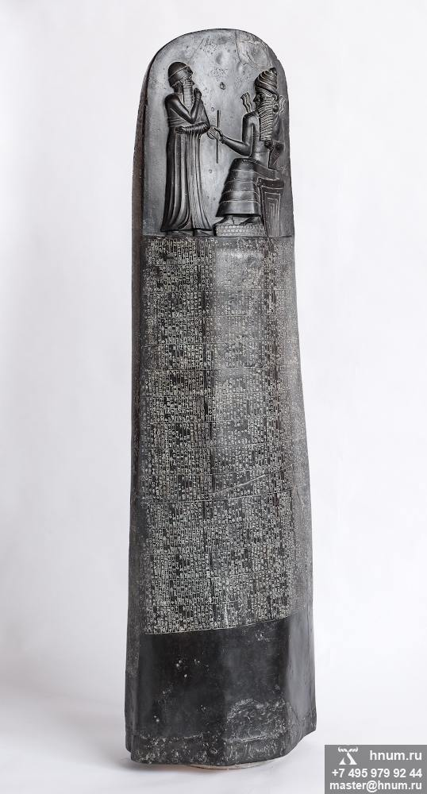

- **Контекст:** Ок. 1750 г. до н.э., найдена в Сузах. Монументальный конический столб из черного базальта.

- Верхний регистр украшен барельефом: царь Хаммурапи предстоит перед восседающим богом солнца и правосудия Шамашем, принимая знаки власти (жезл и кольцо). Нижняя часть столба покрыта 282 статьями законов клинописью. Законы написаны на аккадском языке. (К слову, шумерский язык никуда не исчез - он был в Вавилоне языком богослужения, как церковнослав у русских)

- **Идея:** Доказательство божественного происхождения царского кодекса: закон не выдуман человеком, а вручен высшим космическим судьей.

- _ЗАДАНИЕ НА УРОК:_ Опишите позу царя перед богом Шамашем. Какие детали показывают диалог смертного правителя с высшей силой?

---

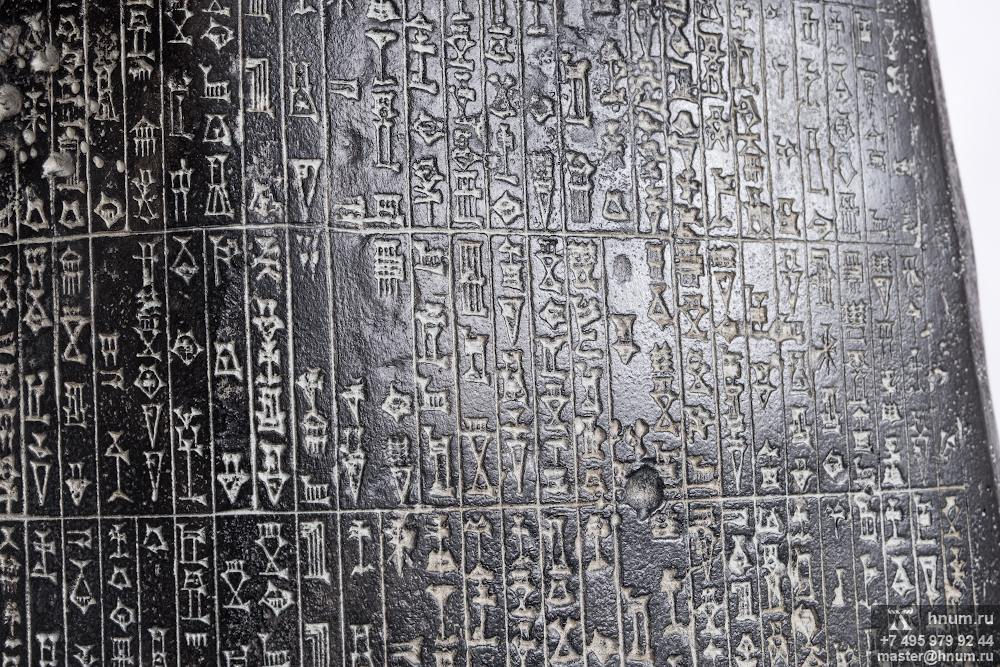

## Закат Вавилонии

К 13 веку до н.э. в борьбу с Вавилонией, ослабевшей от войн с многочисленными племенами кочевников, вступает новое государство - Ассирия.
Сначала Вавилония вошла в состав Ассирии на особых правах - ассирийский царь даже отдельно короновался в Вавилоне, чтобы подчеркнуть этот статус.
Но в 689 году до н. э. после очередного крупного мятежа ассирийская армия взяла Вавилон штурмом. Город был жестоко разрушен до основания, храмы сожжены, а уцелевшие жители частью перебиты, частью переселены на север. Согласно легендам, ассирийские инженеры даже изменили русло Евфрата, чтобы вода смыла остатки города, а сам Вавилон был «проклят».
Позже Вавилон был отстроен заново, но уже ассирийцами.
На смену эпохе законов и писаных правил пришла цивилизация, прославляющая культ силы и жестокости.

## АССИРИЯ

## Ассирийская империя: культ силы и триумфа

- В I тыс. до н.э. Ассирия становится безжалостной военной сверхдержавой, покорившей весь Ближний Восток. Столицей становится город Ниневия. Ассирийцы были отдельным народом, в Вавилонии же жило великое множество разных народов, то есть, господство Ассирии над остальными воспринималось ими как иго. Это означает, что вавилоняне будут поднимать восстания, а ассирийцы - жестоко их подавлять.

- Искусство полностью подчиняется государственной пропаганде: устрашение врагов, фиксация побед и превосходство верховного бога Ашшура.

## Мифология

- Очень важно остановиться на мифологии всех этих народов.
- В их вере не было разделения на Рай и Ад. все души, независимо от поведения при жизни, попадали в один и тот же мир - мрачный и жуткий Кур.
- В мифах говорится, что пищей умершим служит прах и глина, а пьют они грязную воду.
- Души умерших (тени) бродят там в полузабытьи, одетые в крылья, подобно птицам.
- Над ними летают демоны галлу и когтят умерших за спины.
- при этом ассирийцы смогли обратить этот миф из пустого пессимизма в действие: мол, бог Ашшур требует больше земли за Ассирией. а поскольку образ жизни никак не влияет на загробную жизнь, ассирийцы получали моральное право на геноцид.

## Шеду из Дур-Шаррукина

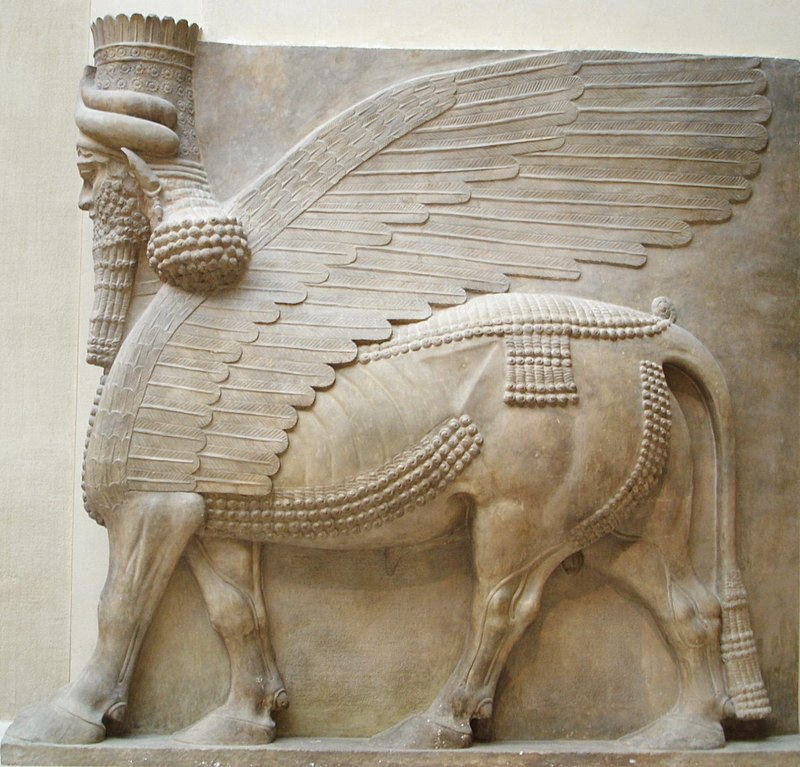

---

- VIII в. до н.э., монументальные стражи ворот дворца царя Саргона II в Хорсабаде.

- Колоссальные статуи крылатых быков (или львов) с бородатыми человеческими головами в рогатых тиарах. Скульптура наделена пятью ногами: спереди страж кажется неподвижно стоящим, а сбоку — делающим уверенный шаг вперед.

- **Идея:** Апотропей (оберег) дворцовых ворот, соединяющий силу быка, полет орла, разум царя и святость божества для защиты от врагов и демонов.

## Ассирийские рельефы дворцового комплекса царя Ашшурбанипала

.jpg>)

---

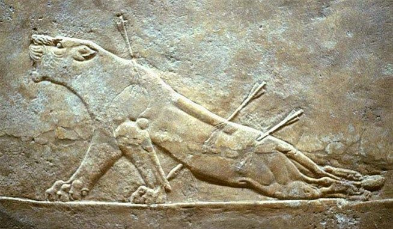

---

- VII в. до н.э., рельефы из дворцовых ансамблей царя Ашшурбанипала в Ниневии.

- Непрерывные ленточные барельефы на плитах из мягкого алебастра. Сцены царской охоты демонстрируют пронзительный натурализм и анатомическую точность агонии раненых зверей на контрасте с бесстрастным ликом царя.

- **Идея:** Сакральная охота символизировала победу ассирийского царя над первозданным хаосом природы и защиту миропорядка.

## Падение Ассирии

Произошло ровно то же, что с Шумером - великая засуха.
Неурожай, голод, у армии не хватало сил защищаться и этим воспользовался Вавилон.
В 626 году до н. э. Вавилон поднимает восстание против ассирийского господства. Вместе с Мидией (первое ираноязычное государство) Вавилония разрушает некогда устрашающую Ассирийскую империю.
Вавилон возрождается из пепла.

# НОВЫЙ ВАВИЛОН

## НОВЫЙ ВАВИЛОН

## Вавилон при Навуходоносоре II

- После падения жестокой Ассирии в конце VII в. до н.э. Вавилон переживает свой наивысший культурный и строительный расцвет при Навуходоносоре II.

- Город превращается в крупнейший архитектурный центр древнего мира, укрепленный мощными стенами и рвами.

- На смену кровавым сценам ассирийских баталий приходит торжественный орнаментальный триумф священных процессий и сияющей глазури.

## Ворота Иштар и Дорога процессий

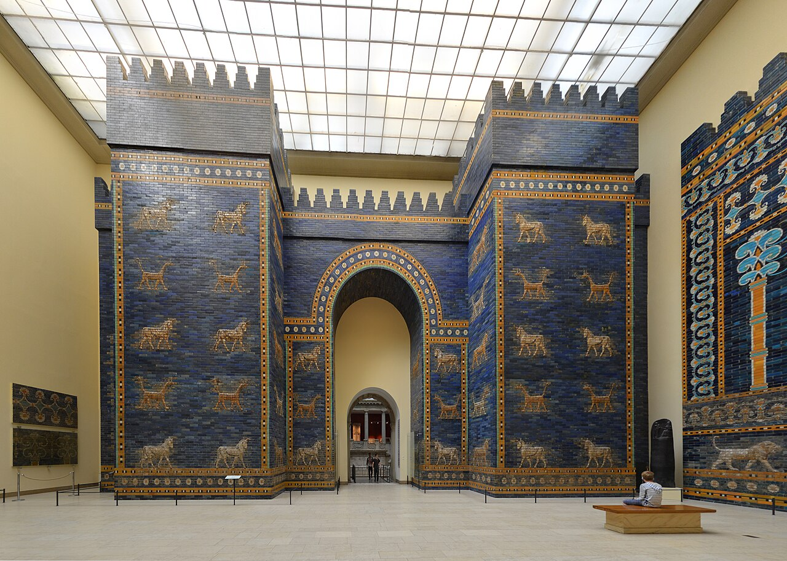

---

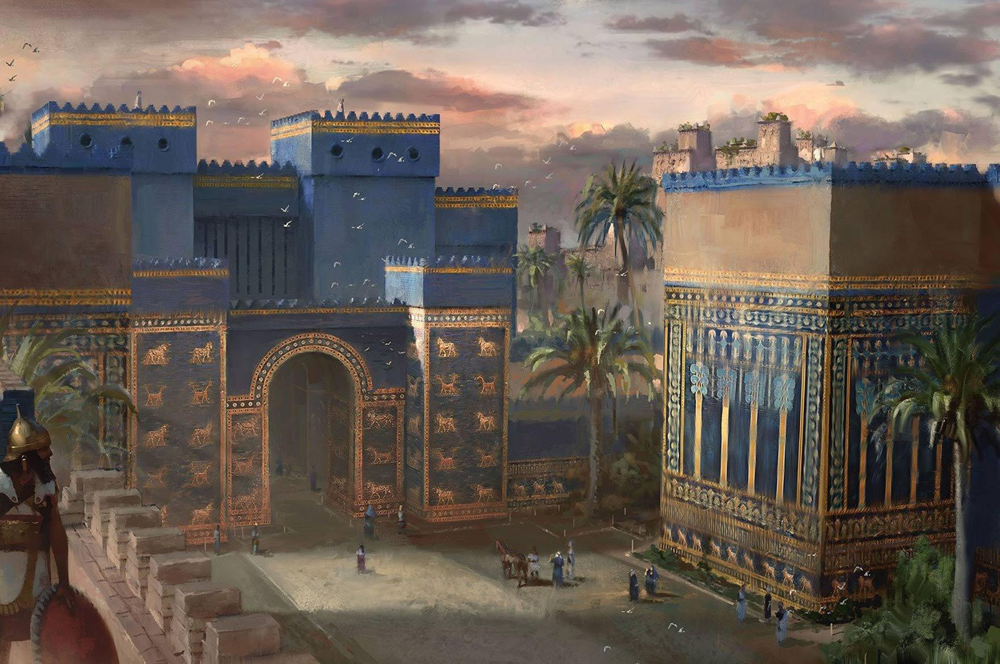

---

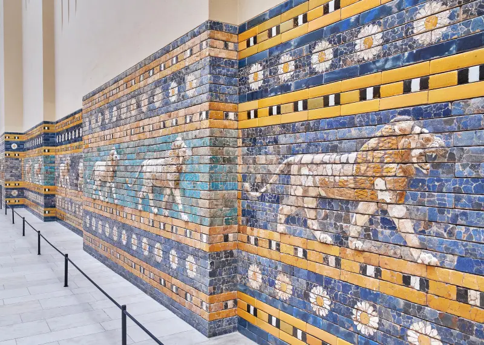

---

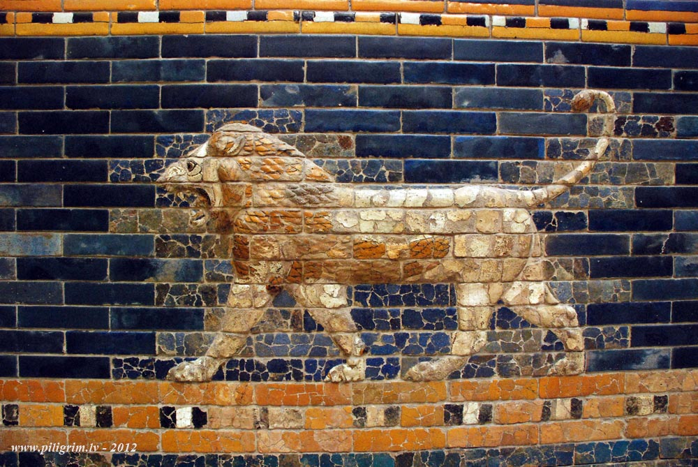

---

- VI в. до н.э. (ок. 575 г. до н.э.), ворота служили парадным северным въездом в Вавилон. Они освящены именем богини плодородия и войны Иштар.

- Монументальные сдвоенные ворота с полуциркульными арками, облицованные обожженным кирпичом с глубокой кобальтово-синей глазурью. Стены украшены рельефными фигурами священных быков и драконов Мушхушшу. К воротам вела Дорога процессий с фризом из 120 шагающих львов.
- Ромашки под львами - это скорее всего не ромашки, а звезды богини Иштар. Но возможно, это и цветы, символизирующие плодородие.

- **Идея:** Поразить воображение иноземных послов и паломников, продемонстрировав неземную пышность города и защиту богов Мардука и Иштар. Львы символизируют военное могущество, а общая эстетика и символы плодородия подчеркивают богатство Вавилона.

## Словарь

**Глазурь** - тонкое стекловидное покрытие, которое наносят на глиняное изделие и закрепляют обжигом.

**Рельеф** - объемное, выпуклое или заглубленное изображение, которое выступает над плоскостью изделия или уходит в нее.

## Конец Месопотамии

- К первым векам нашей эры плодородие почв Тигра и Евфрата стало иссякать. Вновь проблемы с земледелием оказались для местных государств фатальными:
- Эпоха Древней Месопотамии закончилась в 539 году до н. э. с падением Вавилона, когда регион был завоеван персидским царем **Киром II Великим** и включен в состав империи Ахеменидов.
- Это событие завершило трехтысячелетнюю историю независимых месопотамских государств (Шумера, Аккада, Ассирии и Вавилонии).

# Заключение

## Вклад Месопотамии в искусство

- Культура Двуречья подарила человечеству базовые институты: городскую среду, письменность, монументальное право, ирригацию, календарь и основы математики.

- В условиях отсутствия природного камня архитекторы Месопотамии разработали арочно-сводчатые конструкции, террасное строительство и технику глазурованного фасадного кирпича.

- Искусство прошло путь от раннего благоговейного диалога человека с грозными стихиями к прославлению империи, военной доблести и богатства.

# Что необходимо запомнить

## Ключевые черты

- **Материал формирует стиль:** преобладание глины и сырцового кирпича определило массивность стен, отсутствие внешних колоннад и рождение ступенчатых террас.

- **Шумер:** теократическое государство, храмы на платформах, большеглазые адоранты, мозаики с горизонтальными композиционными линиями.

- **Аккад:** имперское самосознание, триумфальный динамизм, экспрессия, прославление царя-воителя.

- **Вавилон:** фиксация незыблемого божественного закона (Стела Хаммурапи) и декоративная роскошь (Ворота Иштар).

- **Ассирия:** беспощадный язык военной мощи, непревзойденный реализм звериных рельефов, крылатые пятиногие хранители шеду.

## Произведения и ключевые слова

- **Ключевые памятники:** Зиккурат в Уре, Штандарт из Ура, Статуя Эбих-Иля (адорант), Стела Нарам-Сина, Стела Хаммурапи, Быки Шеду, Раненая львица из Ниневии, Ворота Иштар.

- **Зиккурат** — культовое ступенчатое сооружение в Древней Месопотамии, состоящее из нескольких террас из необожженного кирпича.
- **Адорант** — скульптура молящегося человека с прижатыми к груди руками и преувеличенными глазами, помещавшаяся в храме перед статуей бога.
- **Глазурь** - тонкое стекловидное покрытие, которое наносят на глиняное изделие и закрепляют обжигом.
- **Рельеф** - объемное, выпуклое или заглубленное изображение, которое выступает над плоскостью изделия или уходит в нее.
- **Иератический масштаб** — художественный закон, по которому размер персонажа напрямую зависит от его сакрального или политического статуса.
- **Каунакес** — шумерская ритуальная одежда в виде ярусной юбки из шерсти или овчины со стилизованными лепестками.
- **Клинопись** — древнейшая система словесно-слогового письма, наносившаяся тростниковой палочкой на влажные глиняные таблички.
